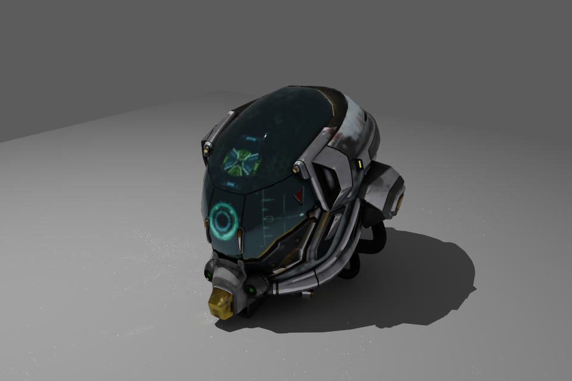

# snr — Slang Neural Renderer

snr is a C++20 / Slang research renderer for glTF scenes on Vulkan through
[slang-rhi](https://github.com/shader-slang/slang-rhi). It provides an interactive raster preview
and progressive path tracing. Neural rendering is a [long-term goal](#roadmap).



DamagedHelmet, rendered in snr at 960 × 640 and 2048 samples per pixel.
[Reproduce this image and see model credits](docs/usage.md#readme-image).

## Current capabilities

| Area | Current state |
| --- | --- |
| Scene import | glTF 2.0 (`.gltf` / `.glb`), instancing, PBR textures, per-slot UV transforms and alpha modes |
| Path tracing | Progressive hardware ray queries, NEE, MIS, reflection and transmission |
| Raster preview | Single-pass forward shading, direct-light shadows and debug views |
| Materials | Transmission, volume absorption and IOR extensions; [semantics and limits](docs/reference/light-transport.md#transmission-and-volume-transport) |
| Utilities | Optional studio floor / point light (`--studio`), tone-mapped PNG and linear HDR output |
| Neural rendering | Planned; see the [roadmap](#roadmap) |

## Requirements

- A GPU and Vulkan driver supporting **hardware ray queries and bindless descriptors**.
  Both Raster and Path tracing require these features.
- A C++20 compiler, CMake 3.25 or newer, Ninja and Python 3.
  The current Windows build uses Clang.
- The Vulkan SDK with Slang compiler libraries, headers and `slangc`; set `VULKAN_SDK` to its root.
- Git and the repository's pinned submodules under `external/`.

Runtime checked on Windows with an NVIDIA GeForce RTX 4070. Other operating systems and GPU
vendors are unverified. GPU support is determined by the features exposed by the driver.

## Building

Run from the repository root, with the compiler and build tools available on PATH:

```sh
git submodule update --init --recursive
cmake --preset default
cmake --build build
```

The default preset uses Slang from the Vulkan SDK. On Windows, the build reconstructs the Slang
CMake targets from the SDK's binaries and headers. Configuration and builds do not download
dependencies; initialize the submodules first.

For an existing custom Slang installation, override the package directory:

```sh
cmake --preset default -Dslang_DIR="/path/to/slang/install/lib/cmake/slang"
```

The optional `slang-source-build` preset is a local development convenience pointing to
`../slang/build-snr/Release/install/lib/cmake/slang`. It expects that installation to exist;
it does not build Slang. The override above accepts another installation layout.
The Vulkan SDK is still required when using custom Slang.

## Quick start

These commands use the Windows executable name and run from the repository root.
Open the GUI, then use **Import glTF / GLB** to select a model:

```sh
build/snr.exe --window
```

Or render a bundled Khronos sample asset without opening a window:

```sh
build/snr.exe --model DamagedHelmet --studio --width 960 --height 640 --spp 256 --output output/damaged-helmet.png
```

Headless rendering writes the requested PNG and an HDR file with the same basename. The GUI starts
in Raster mode; select Path tracing to accumulate samples. Full controls, examples and CLI options
are in [Usage](docs/usage.md).

## Documentation

After your first run, read the
[architecture](docs/architecture.md) from the system overview through scene preparation,
rendering, output and state changes. Follow its topic links when you need implementation details.

| Need | Read |
| --- | --- |
| Use the GUI, choose CLI options or reproduce the example image | [Usage](docs/usage.md) |
| Understand the system and follow a scene to an image | [Architecture](docs/architecture.md) |
| Change scene import or CPU representation | [Scene data](docs/reference/scene-data.md) |
| Change shared layouts, GPU resources or bindings | [GPU resources](docs/reference/gpu-resources.md) |
| Understand path tracing, materials, sampling or volumes | [Light transport](docs/reference/light-transport.md) |
| Change Raster or window presentation | [Rasterizer](docs/reference/rasterizer.md) / [Presentation](docs/reference/presentation.md) |
| Test renderer changes | [Renderer tests](tests/README.md) |
| Modify the project with an AI agent | [Repository rules and workflow](AGENTS.md) |

## Roadmap

Planned work keeps both training and inference in Slang, using its automatic differentiation:

| Integration point | Planned features |
| --- | --- |
| After rendering | Denoising, super resolution, frame generation |
| Inside light transport | Neural textures, neural materials, neural radiance caching |

## Dependencies

| Dependency | Purpose |
| --- | --- |
| [Slang](https://github.com/shader-slang/slang) | Shader language and compiler |
| [slang-rhi](https://github.com/shader-slang/slang-rhi) | GPU abstraction over Vulkan |
| [tinygltf](https://github.com/syoyo/tinygltf) | glTF 2.0 parsing |
| [glm](https://github.com/g-truc/glm) | Vector and matrix math |
| [GLFW](https://github.com/glfw/glfw) | Interactive window (Git submodule) |
| [Dear ImGui](https://github.com/ocornut/imgui) | GUI controls and file browser (Git submodule) |
| [stb](https://github.com/nothings/stb) | Image writing |
| [glTF-Sample-Assets](https://github.com/KhronosGroup/glTF-Sample-Assets) | Test models |
| Vulkan SDK | Device, ray queries, validation |
