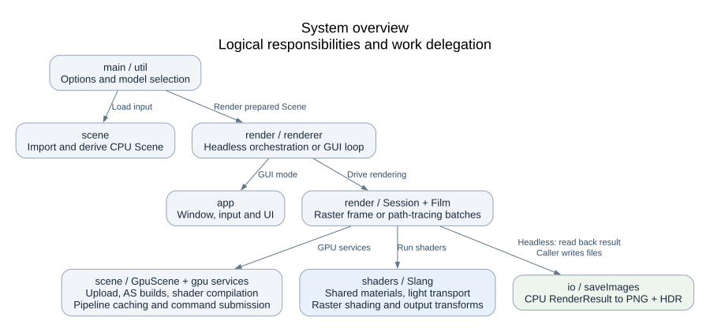
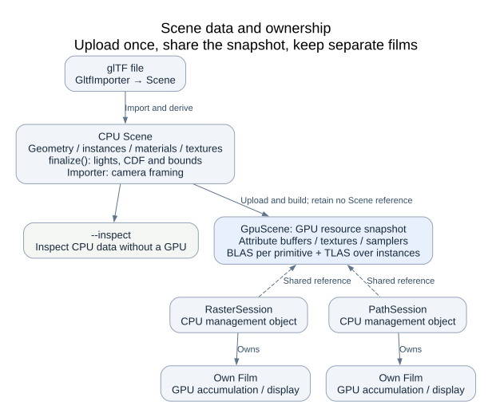
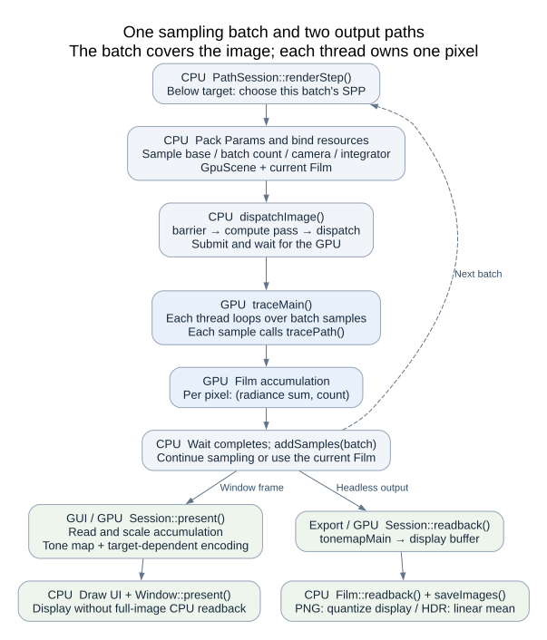

# Architecture

After [building and running the project](../README.md#building), read this document from top to
bottom to understand how a scene becomes an image. It assumes basic C++ and graphics knowledge;
project-specific objects are introduced before their role in rendering.

This document describes the current architecture. The [roadmap](../README.md#roadmap) records
planned work.

- [System overview](#system-overview)
- [Core objects](#core-objects)
- [From scene to image](#from-scene-to-image)
- [State changes and resource lifetime](#state-changes-and-resource-lifetime)
- [Code map](#code-map)

## System overview

snr is a C++20 / Slang renderer for glTF scenes. C++ prepares scene data and submits Vulkan work
through slang-rhi; Slang shaders perform GPU shading. Neural training and inference are planned.



The diagram shows logical responsibilities and work delegation, rather than include dependencies
or submission timing. The main areas are:

| Area | Responsibility |
| --- | --- |
| `src/main.cpp`, `src/util/` | Parse options, select an input model and handle CPU inspection |
| `src/scene/` | Import glTF, derive CPU scene data and create a GPU scene snapshot |
| `src/render/` | Coordinate headless / GUI execution, render sessions and image storage |
| `src/app/` | Manage windows, camera input and UI controls |
| `src/gpu/` | Manage the device, compile shaders at runtime, cache pipelines and submit commands |
| `shaders/` | Evaluate shared materials, trace paths, shade raster fragments and transform output |
| `src/io/` | Write CPU render results to image files |

The GUI starts with Raster for an immediate preview. Path tracing progressively accumulates samples
for indirect lighting and reflection / transmission paths. Both use the same GPU scene representation,
shared material evaluation and Film output format. Their lighting methods differ; Raster remains
a preview approximation. Detailed material support and limits are in
[light transport](reference/light-transport.md#transmission-and-volume-transport).

## Core objects

| Object | Role |
| --- | --- |
| `Scene` | CPU geometry, instances, materials, textures, lights and initial camera |
| `GpuScene` | Uploaded snapshot: GPU buffers, textures, samplers and acceleration structures |
| `Session` | Rendering settings and a Film, with a shared reference to a GpuScene |
| `RasterSession` / `PathSession` | The renderer-specific pipelines and work that fill a Film |
| `Film` | GPU accumulation / display buffers and a CPU sample counter |
| `RenderResult` | CPU copies of an image and its sample metadata, returned by readback |

Scene preparation leads to a GpuScene; a Session renders into its Film; readback produces a
RenderResult when CPU output is needed. These names describe different storage and ownership roles.



Solid arrows show data creation or transfer; dashed arrows show a Session holding a shared
reference. Session and Film are C++ management objects on the CPU. The buffers, textures and
acceleration structures they manage reside on the GPU.

A primitive is a triangle range with one material; an instance places a primitive in the world
with a transform. A bottom-level acceleration structure (BLAS) accelerates one primitive;
a top-level structure (TLAS) assembles them using instance transforms.

## From scene to image

### CPU preparation

`GltfImporter` handles file reading, material import and geometry import.
`Scene` holds geometry attribute arrays, primitives, instances, materials, textures and lights,
along with the camera and bounds. The importer retains the parsed glTF model so it can derive
another glTF scene without reading the file again.

`Scene::finalize()` derives lights, their sampling cumulative distribution (CDF) and bounds from
the prepared geometry and instances. The CDF selects lights according to their weights.
The shader consumes these precomputed light records and probabilities; it does
not rebuild a light list per pixel. `--inspect` exports the CPU data before any GPU device exists,
which makes it useful for isolating import problems.

See [scene data](reference/scene-data.md) for primitives, instances and local vertex indexing.

### Uploading a GPU snapshot

The `GpuScene` constructor uploads attributes, materials, lights, textures and samplers and builds
BLAS/TLAS. The same GPU positions and indices buffers serve both acceleration-structure construction
and shader reads. BLAS build commands are recorded first, followed by a barrier and the TLAS build.
Submission waits for completion before temporary scratch buffers are released.

`GpuScene` does not retain its input `Scene&`. Subsequent rendering uses the uploaded snapshot.
A caller may still retain the CPU Scene, but editing it does not update existing GPU resources:
a new or replacement snapshot is required. Sessions manage their camera, integrator settings and
environment values separately, with dedicated setters. Integrator settings control light transport,
including the bounce limit, random seed and next-event estimation (NEE), which samples direct light.

See [GPU resources](reference/gpu-resources.md) for the shared data and resource contracts.

### Rendering into Film

Each Film pixel stores a **radiance sum and sample count**. Radiance is the linear light value
computed for a sample. Display and export divide the sum by the count to obtain the mean.
In [traceMain](../shaders/pathtracer.slang), each sample contributes:

```slang
sum += float4(tracePath(params.eye.xyz, direction, pixelAngle, rng), 1);
```

Here, `sum.rgb` accumulates radiance and `sum.w` counts samples. This representation lets rendering
extend the Film while display and export read its current mean.

The two renderers produce this same representation in different ways:

| Renderer | Work that fills Film | Result after the work completes |
| --- | --- | --- |
| Raster | Draw scene instances into a color target, then copy it into accumulation | One sample per pixel, replacing the previous frame |
| Path tracing | Dispatch a compute batch whose threads trace camera samples | Add the batch's samples to the current accumulation |

#### Raster frame

`RasterSession::render()` clears its color, object-id and depth targets, then draws OPAQUE / MASK
instances followed by sorted BLEND instances. Vertex shaders fetch scene geometry; fragment
shaders evaluate shared materials, direct lighting and the transmission preview. Shadow and
transmission queries use the same TLAS as path tracing.

After the pass, a texture-to-buffer copy places linear color into Film with a per-pixel count of one.
The CPU waits for submission to complete before recording one Film sample. Each Raster render
replaces its previous image. The [Raster design](reference/rasterizer.md) explains shared geometry,
visibility and the preview's approximations.

#### Path-tracing batch



There are three nested loops. Understanding their boundaries matters more than memorizing class names:

| Loop | Where it runs | Work per iteration |
| --- | --- | --- |
| Sampling batch | CPU: `PathSession::renderStep()` | Schedule GPU work over the entire image |
| Samples for one pixel | GPU: `traceMain()` | Compute this batch's camera samples |
| Bounces for one sample | GPU: `tracePath()` | Collect light along the path until termination |

**One displayed frame is not one sample.** The GUI advances at most one batch per frame, and a
batch can contain multiple samples per pixel (SPP). Headless rendering repeats batches until it
reaches the target.

Suppose Film already contains 8 SPP, the target is 10 SPP, and the batch size is 4 SPP:

1. The CPU chooses the remaining 2 samples per pixel and prepares the rendering state.
2. GPU threads read the shared scene and compute those camera samples for their pixels.
3. Each thread adds the samples' radiance and count to its Film pixel.
4. The CPU waits for completion, then advances its completed sample count from 8 to 10.

The handoff in [PathSession::renderStep()](../src/render/session.cpp) carries the starting sample
index in `Params.image.z` and this batch's count in `Params.image.w`:

```cpp
params.image.z = samples();
params.image.w = std::min(m_settings.batchSize, target - samples());
```

The GPU scene is reused across batches. Every compute batch includes a CPU wait, so multiple
sampling batches are not kept asynchronously in flight.

For the per-sample transport model, continue to [light transport](reference/light-transport.md).

The CPU Film counter schedules batches; GPU pixels retain their accumulated sample counts.
File export checks that the counts agree before producing an image.

### Presentation and file output

| Output | GPU work | CPU work |
| --- | --- | --- |
| GUI window | Read, fit and tone map Film into a swapchain image | Draw UI and present; regular display does not read the full image back |
| Headless files | Tone map Film into its display buffer | Read linear and display images into RenderResult, then write PNG and HDR |

Both paths share exposure and Reinhard tone mapping.
The GUI uses hardware encoding for sRGB swapchain targets and shader encoding for other target
formats. PNG export quantizes the tone-mapped display values without adding sRGB encoding.
Sharing tone mapping therefore does not imply identical window and PNG encoding.
HDR comes from averaged linear accumulation, without display exposure or tone mapping.

Headless rendering writes both the requested `.png` and a `.hdr` with the same basename.
The GUI does not save files on exit. `RenderResult` owns the CPU copies used for file output;
the headless renderer releases its Session before calling `saveImages()`.

See [presentation](reference/presentation.md) for the display and window boundaries and code entry points.

## State changes and resource lifetime

### Ownership and lifetime

| Resource | Owner or holder | Lifetime contract |
| --- | --- | --- |
| `DeviceContext` | Headless call or GUI loop | Outlives its shader libraries, sessions, films and window resources |
| `ShaderLibrary` | Headless renderer scope or GUI loop | Outlives sessions that borrow it; sessions also retain their pipelines |
| `Scene` | Import caller; a worker prepares GUI replacements | GpuScene retains no input Scene reference after upload |
| `GpuScene` | Shared by sessions through `shared_ptr` | Remains alive while any session holds it; resources belong to this snapshot |
| `Film` | One Session | Accumulation / display buffers are replaced on resize and released with the Film |
| `RenderResult` | Readback caller | Owns CPU vectors independent of subsequent rendering and GPU resource lifetime |

Interactive mode creates a `RasterSession` first. The first switch to Path tracing creates a
`PathSession`, sharing the GpuScene while allocating its own Film. Switching renderers therefore
reuses geometry, textures and acceleration structures without
mixing the two renderers' pixel results. **Raster also needs the TLAS**: fragment shaders use ray
queries for shadows and transmission preview.

### What invalidates accumulated samples

Samples can be combined only while scene, camera, image size, integrator and other relevant
conditions remain compatible.

| Operation | GPU scene snapshot | Path-tracing Film |
| --- | --- | --- |
| Change camera | Retained | Reset when the value changes |
| Change image size | Retained | Reallocate buffers and reset when the size changes |
| Change integrator or environment | Retained | Reset when the value changes |
| Change exposure | Retained | Preserve samples; update display |
| Raise target SPP / change batch SPP | Retained | Preserve samples and continue |
| Lower target SPP | Retained | Reset only if the new target is below the accumulated count |
| Click Restart | Retained | Reset |
| Switch GUI renderer | Shared snapshot | Separate films; current camera, size and settings determine whether the cached path film can continue |
| Successfully import another model in the GUI | Build a replacement snapshot | Replace RasterSession and discard the old PathSession |
| Call `PathSession::setScene()` | Build a new snapshot for this session | Reset; other sessions retain their original snapshot |

**Reset currently only sets the CPU sample count to zero; it does not immediately clear GPU buffers.**
The first batch after a reset replaces the previous accumulation. Later batches extend it.
`traceMain()` starts a fresh sum when the starting sample index, `Params.image.z`, is zero.
Until rendering resumes, old buffer contents remain allocated but are no longer valid samples.

Even when paused, the GUI computes one fresh batch after reset so the displayed image matches
the current state. These rules live in the
[Session / PathSession setters](../src/render/session.cpp),
[Film::reset](../src/render/film.h), [traceMain](../shaders/pathtracer.slang)
and [interactive loop](../src/render/renderer.cpp).

### Switching renderers

Only the active GUI session receives the current camera, resolution and controls. On returning to
a cached PathSession, setters compare those values with its retained state. An unchanged round
trip resumes the existing accumulation (or remains complete if its target was reached). A changed
camera, resolution or integrator resets it on return. Exposure changes preserve samples.

### Replacing a scene

During GUI model import, CPU parsing and texture decoding run on a worker. GPU resource creation
stays on the rendering thread. Only after a replacement RasterSession has been built and the queue
has been waited on does the application replace the old session and discard the old PathSession.
A failed import preserves the working scene and camera.

### Window resources

Dear ImGui's detached panels each have a GLFW window and a slang-rhi surface. Release the native
surface before destroying its GLFW window. Platform windows continue updating while the main
surface is minimized; the GUI loop waits on the queue before shutdown.
See [presentation](reference/presentation.md) for window fitting, platform callbacks and code entry points.

## Code map

Use this map to locate the implementation after following the execution above.
For the complete documentation directory, see the [README index](../README.md#documentation).

| Source | Responsibility |
| --- | --- |
| [main.cpp](../src/main.cpp) | CLI parsing, initial model selection and `--inspect` |
| [gltf_importer.cpp](../src/scene/gltf_importer.cpp), [scene.cpp](../src/scene/scene.cpp) | Import and CPU scene derivation |
| [gpu_scene.cpp](../src/scene/gpu_scene.cpp) | Uploads, descriptors, acceleration structures and draw metadata |
| [session.cpp](../src/render/session.cpp), [film.cpp](../src/render/film.cpp) | Session setters, progressive batches and image storage |
| [dispatch.h](../src/render/dispatch.h), [device.cpp](../src/gpu/device.cpp) | Compute recording, submission and synchronization |
| [shader_library.cpp](../src/gpu/shader_library.cpp) | Runtime module loading, composition, diagnostics and pipeline caching |
| [renderer.cpp](../src/render/renderer.cpp) | Headless orchestration, GUI loop and asynchronous model import |
| [rasterizer.cpp](../src/render/rasterizer.cpp) | Raster targets, pipeline variants and draw loop |
| [window.cpp](../src/app/window.cpp), [preview_ui.cpp](../src/app/preview_ui.cpp) | Swapchain, input, ImGui and detached panels |
| [image_output.cpp](../src/io/image_output.cpp) | PNG / HDR output |
| [pathtracer.slang](../shaders/pathtracer.slang) | `traceMain`, `tracePath` and ray cones |
| [scene.slang](../shaders/scene.slang) | Ray queries, hit resolution and scene resource declarations |
| [material_eval.h.slang](../shaders/material_eval.h.slang) | Shared attribute / texture lookup, material evaluation and light helpers |
| [bsdf.slang](../shaders/bsdf.slang), [medium.slang](../shaders/medium.slang) | BSDF evaluation / sampling and medium state |
| [rasterizer.slang](../shaders/rasterizer.slang) | `rasterVS`, `rasterOpaqueFS`, `rasterFS` and preview shading |
| [present.slang](../shaders/present.slang), [tonemap.h.slang](../shaders/tonemap.h.slang) | Window presentation and shared tone-mapping functions |
| [sampling.slang](../shaders/sampling.slang) | RNG, sampling distributions, MIS heuristic and ray offsets |
| [scene_io.h.slang](../shaders/scene_io.h.slang) | Shared host/device records |
| [Dependencies.cmake](../cmake/Dependencies.cmake) | Local dependency integration |
