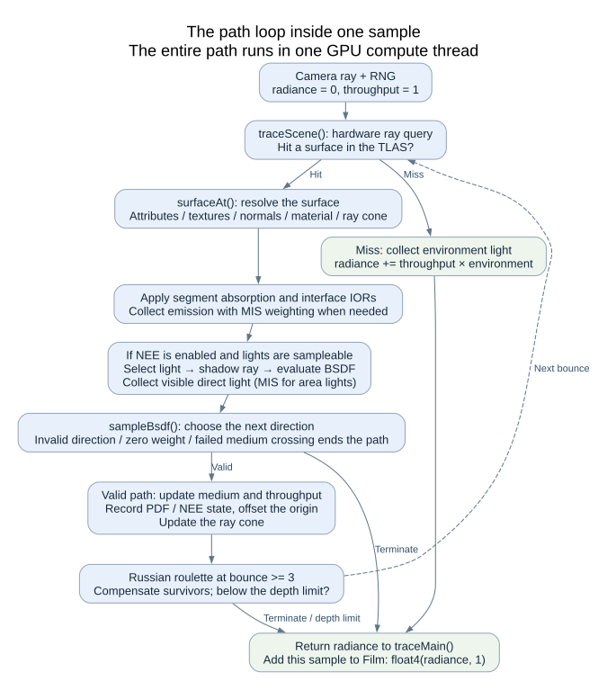

# From scene to image: the CPU / GPU rendering flow

This guide is for a maintainer returning to the project after time away. It should help you explain
**who owns the data, when the CPU hands work to the GPU, how a pixel gets its color, and which
changes invalidate accumulated results.**

This is the current implementation. Start with the three diagrams, then follow the code links
when you need details.
[Project README](../README.md) · [Architecture reference](architecture.md)

## 1. Scene data and ownership

Solid arrows show data creation or transfer; dashed arrows show a Session holding a shared
reference. Session and Film are C++ management objects on the CPU. The buffers, textures and
acceleration structures they manage reside on the GPU.

### CPU preparation

`Scene::loadGltf()` delegates file reading, material import and geometry import to `GltfImporter`.
`Scene` holds geometry attribute arrays, primitives, instances, materials, textures and lights,
along with the camera and bounds. The importer retains the parsed glTF model so it can derive
another glTF scene without reading the file again.

`Scene::finalize()` derives lights, the light sampling CDF and bounds from the prepared geometry
and instances. The shader consumes these precomputed light records and probabilities; it does
not rebuild a light list per pixel. `--inspect` exports the CPU data before any GPU device exists,
which makes it useful for isolating import problems.

Keep these three geometry concepts distinct:

| Concept | Meaning here | GPU use |
| --- | --- | --- |
| Vertex / triangle | Vertex attribute arrays and triangles containing three local vertex indices | Shaders fetch attributes; AS construction reads positions / indices |
| `Primitive` | A triangle range with one material and its own vertex window | One BLAS is built per primitive |
| `Instance` | A transformed placement of a primitive in the world | The TLAS places instances; hits resolve geometry and material through them |

A BLAS accelerates intersection with one primitive. The TLAS assembles those BLASes using instance
transforms to represent the scene. Triangle indices are relative to the primitive's `vertexBase`;
they cannot be used directly as global vertex indices.

### Uploading a GPU snapshot

The `GpuScene` constructor uploads attributes, materials, lights, textures and samplers and builds
BLAS/TLAS. The same GPU positions and indices buffers serve both acceleration-structure construction
and shader reads. BLAS build commands are recorded first, followed by a barrier and the TLAS build.
Submission waits for completion before temporary scratch buffers are released.

`GpuScene` does not retain its input `Scene&`. Subsequent rendering uses the uploaded snapshot.
A caller may still retain the CPU Scene, but editing it does not update existing GPU resources:
a new or replacement snapshot is required. Sessions manage their camera, integrator settings and
environment values separately, with dedicated setters.

### Shared scene, separate films

`Session` holds a `shared_ptr<GpuScene>`, rendering settings and its own `Film`.
Film manages the GPU accumulation / display buffers and a CPU accumulated-sample counter.

Interactive mode creates a `RasterSession` first. The first switch to Path tracing creates a
`PathSession` through `Session(shaders, source)`, sharing the GpuScene while allocating its own
Film. Switching renderers therefore reuses geometry, textures and acceleration structures without
mixing the two renderers' pixel results. **Raster also needs the TLAS**: fragment shaders use ray
queries for shadows and transmission preview.

During GUI model import, CPU parsing and texture decoding run on a worker. GPU resource creation
stays on the rendering thread. Only after a replacement RasterSession has been built and the queue
has been waited on does the application replace the old session and discard the old PathSession.
A failed import preserves the working scene and camera.

Code: [Scene](../src/scene/scene.h) /
[importer](../src/scene/gltf_importer.cpp) /
[GpuScene](../src/scene/gpu_scene.cpp) /
[Session](../src/render/session.h) /
[interactive loop](../src/render/renderer.cpp).

## 2. One sampling batch

There are three nested loops. Understanding their boundaries matters more than memorizing class names:

| Loop | Where it runs | Work per iteration |
| --- | --- | --- |
| Sampling batch | CPU: `PathSession::renderStep()` | Dispatch one compute pass over the entire image |
| Samples for one pixel | GPU: the `i` loop in `traceMain()` | A thread computes this batch's camera samples sequentially |
| Bounces for one sample | GPU: the `bounce` loop in `tracePath()` | Accumulate radiance along the path until termination |

**One displayed frame is not one sample.** The GUI calls renderStep at most once per frame, and a
batch can contain multiple samples per pixel (SPP). For headless output, `PathSession::render()`
repeats renderStep until it reaches the target.

### CPU parameters, bindings and submission

Suppose Film already contains 8 SPP, the target is 10 SPP, and the batch size is 4 SPP:

1. `renderStep()` chooses `min(4, 10 - 8) = 2` samples for this batch.
2. `makeParams()` packs camera, environment and integrator values.
   `Params.image = (width, height, 8, 2)`: `.z` is the starting sample index and `.w` is the batch count.
3. `dispatchImage()` creates an encoder, inserts a barrier, begins a compute pass and binds the
   `traceMain` pipeline.
4. `bindParams()` binds constants, `GpuScene::bind()` binds scene resources, and the caller binds
   Film accumulation. Binding establishes shader access; it does not upload the scene again.
5. Dispatch covers `ceil(width / 8) × ceil(height / 8)` thread groups, each containing `8 × 8` threads.
6. After ending the pass and inserting a barrier, `submitAndWait()` submits and waits for the
   graphics queue. Only then does `Film::addSamples(2)` advance the CPU count to 10.

Every compute batch currently includes a CPU wait. Multiple sampling batches are not kept
asynchronously in flight.

### GPU pixel work

`traceMain()` rejects threads outside the image extent, then obtains the pixel's accumulation.
For each sample it seeds the RNG from pixel, sample index and seed, jitters the location within
the pixel, generates a ray from the camera basis and calls tracePath.
It adds `float4(radiance, 1)` for each sample and writes the pixel once after the batch loop.

A Film pixel stores **`(radiance sum.rgb, sample count)`**, rather than an averaged color.
Display and export calculate `sum.rgb / sum.w`.
The CPU Film counter schedules the next batch; each GPU pixel's `.w` records its actual count.
`saveImages()` checks that the GPU counts agree with the CPU count when exporting.

### Two output paths

| Output | GPU work | CPU work |
| --- | --- | --- |
| GUI window | `Session::present()` draws a fullscreen triangle, reading, scaling and tone mapping accumulation into the swapchain image | Draw UI, then call `Window::present()`; regular display does not read the full image back |
| Headless files | `Session::readback()` dispatches `tonemapMain` into Film's display buffer | `Film::readback()` reads accumulation and display; `saveImages()` writes PNG and HDR |

Both paths use `tonemapCore` for exposure and Reinhard mapping.
The GUI relies on hardware encoding for sRGB swapchain targets, and presentFS explicitly encodes
other target formats. Current `tonemapMain` only writes tone-mapped values into display;
`saveImages()` quantizes them directly to PNG bytes without adding sRGB encoding.
Sharing tone mapping therefore does not imply identical window and PNG encoding.
HDR comes from averaged linear accumulation, without display exposure or tone mapping.

Code: [batch execution](../src/render/session.cpp) /
[compute dispatch](../src/render/dispatch.h) /
[submission and waiting](../src/gpu/device.cpp) /
[Film](../src/render/film.cpp) /
[presentation shader](../shaders/present.slang) /
[file output](../src/io/image_output.cpp).

## 3. One path inside a GPU thread

`tracePath()` completes the entire path inside a single compute thread. Hardware ray queries
accelerate intersection; shader code then fetches hit attributes and evaluates materials.
There are no separately dispatched ray-generation or closest-hit shader stages in this implementation.

Keep two quantities distinct along the path:

- `radiance`: light already collected and eventually returned to the pixel.
- `throughput`: the weight applied to later contributions after traveling along this path; initially 1.

Each bounce follows this order:

1. **Intersect:** `traceScene()` queries the TLAS and handles material visibility at candidate hits.
   A miss adds `throughput × environment` to radiance and returns.
2. **Resolve the surface:** use the hit instance and local triangle index to fetch geometry.
   `surfaceAt()` interpolates attributes, reads textures and evaluates normals and material.
   A ray cone estimates the texture footprint.
3. **Medium and emission:** apply Beer–Lambert absorption over the segment and set the interface IORs.
   Add weighted emission to radiance. When the previous bounce used NEE and this hit is an area
   emitter, an MIS weight balances the two estimators.
4. **Direct-light NEE:** when enabled and a valid light distribution exists, select a light using
   the CPU-built CDF. Sample a point on an area light or use a point light's position. Trace a shadow
   ray, evaluate the BSDF in that direction, and collect visible direct light.
5. **Sample a continuation:** `sampleBsdf()` selects reflection or transmission. Check its direction
   against the geometric normal and inspect its weight; invalid samples terminate.
   Volume transmission updates the medium stack; reflection stays in the current medium.
6. **Update path state:** multiply throughput by the BSDF sample weight, record the PDF, NEE state
   and position, offset the next ray origin and update the ray cone.
7. **Terminate or continue:** apply Russian roulette at zero-based `bounce >= 3`, compensating
   surviving paths by dividing by their survival probability. The maximum bounce count also
   terminates the loop.

The NEE shadow ray answers whether a direct-light contribution is visible. The BSDF sample separately
chooses the next path segment. MIS (multiple importance sampling) weights estimates from different
sampling strategies to avoid double-counting the area-light direct contribution.
For material, PDF, medium and texture details, see [shading details](architecture.md#shading-details)
and [transmission](architecture.md#transmission-and-volume-transport).

Code: [traceMain / tracePath](../shaders/pathtracer.slang) /
[intersection and light queries](../shaders/scene.slang) /
[material evaluation](../shaders/material_eval.h.slang) /
[BSDF](../shaders/bsdf.slang) /
[media](../shaders/medium.slang).

## 4. What invalidates accumulated samples

Samples can be combined only while scene, camera, image size, integrator and other relevant
conditions remain compatible.

| Operation | GPU scene snapshot | Path-tracing Film |
| --- | --- | --- |
| Change camera | Retained | Reset when the value changes |
| Change image size | Retained | Reallocate buffers and reset when the size changes |
| Change integrator or environment | Retained | Reset when the value changes |
| Change exposure | Retained | Preserve samples; update display |
| Raise target SPP / change batch SPP | Retained | Preserve samples and continue |
| Lower target SPP | Retained | Reset only if the new target is below the accumulated count |
| Click Restart | Retained | Reset |
| Switch GUI renderer | Shared snapshot | Separate films; current camera, size and settings determine whether the cached path film can continue |
| Successfully import another model in the GUI | Build a replacement snapshot | Replace RasterSession and discard the old PathSession |
| Call `PathSession::setScene()` | Build a new snapshot for this session | Reset; other sessions retain their original snapshot |

**Reset currently only sets the CPU sample count to zero; it does not immediately clear GPU buffers.**
On the next batch, `Params.image.z == 0` makes traceMain initialize its local sum to zero and
overwrite each pixel. Other batches read the previous accumulation.
If no rendering follows a reset, the old bytes remain in the buffer.

Even when paused, the GUI computes one fresh batch after reset so the displayed image matches
the current state. These rules live in the
[Session / PathSession setters](../src/render/session.cpp),
[Film::reset](../src/render/film.h), [traceMain](../shaders/pathtracer.slang)
and [interactive loop](../src/render/renderer.cpp).

For code locations and detailed contracts, use the [architecture reference](architecture.md#code-map).
Diagram sources and regeneration are documented under [diagram maintenance](diagrams/README.md).
